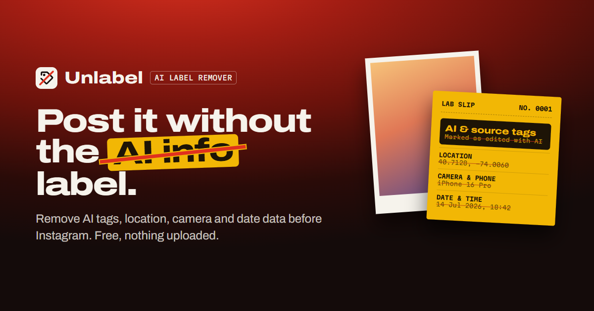

# Unlabel

**AI label remover for Instagram photos.** Unlabel removes the hidden tags that make Instagram add an "AI info" label (C2PA Content Credentials, IPTC DigitalSourceType, AI prompts), plus GPS location, camera and phone details, dates and edit history. It runs entirely in your browser, so your photos never leave your device.

**Use it:** https://anabansal.github.io/unlabel/



## How it works

1. Open the page and drop one photo or a whole batch into the tray. There are no settings and no sign-up.
2. Each photo develops into a print with a lab slip that lists exactly what was removed, AI tags first, plus a Download button. Several photos? **Download all** gives you a ZIP.
3. Upload the clean copies to Instagram yourself.

## What it removes

| Category | Examples |
| --- | --- |
| AI & source tags | C2PA Content Credentials (JPEG APP11, PNG `caBX`, WebP `C2PA`), IPTC `DigitalSourceType` such as `trainedAlgorithmicMedia`, Stable Diffusion / ComfyUI prompts in PNG text chunks |
| Location | EXIF GPS coordinates, XMP and IPTC city / country fields |
| Camera & phone | Make, model, lens, serial number, maker notes |
| Date & time | Capture, creation and modification dates, PNG `tIME` |
| Edit history | XMP history, editing software, Photoshop / Lightroom data, Samsung gallery-editor undo data |
| Hidden preview image | EXIF, JFIF and Photoshop thumbnails that can show the uncropped photo |
| Name & copyright | Artist, owner, copyright, captions, keywords, comments |
| Extra embedded data | MPF images, HDR gain maps, depth maps, anything appended after the image ends |

## What it keeps

- **Pixels.** JPEG, PNG and WebP are edited at the byte level. The compressed image data is copied unchanged, so there is no re-compression and no quality loss.
- **Colors.** The ICC color profile (for example Display P3) and the Adobe color-transform marker stay.
- **Orientation.** A tiny EXIF block holding only the rotation flag is written back, so nothing turns sideways.

HEIC, AVIF, GIF and other formats the browser can decode are saved as a fresh high-quality JPEG with no metadata.

**Limits:** Unlabel can't remove invisible watermarks woven into the pixels themselves (such as Google SynthID), and platforms may still label content based on other signals.

## Privacy

There is no server. The page is static HTML, CSS and JavaScript with zero dependencies and no analytics, fonts or scripts loaded from other sites. After the first visit it also works offline.

## Development

```bash
npm start          # serves the site at http://localhost:8080
npm test           # builds test photos, cleans them, verifies with Pillow
```

Tests need Python with `pillow` and `piexif` (`pip install pillow piexif`). They check that cleaned files decode to identical pixels, keep their rotation and color profile, and contain none of the original private data, and that the ZIP export is valid.

| File | Purpose |
| --- | --- |
| `clean.js` | The cleaner: JPEG segment, PNG chunk and WebP chunk parsers |
| `zip.js` | Minimal ZIP writer for "Download all" |
| `app.js` | Page logic: drop, paste, cards, downloads |
| `index.html`, `style.css` | The page |
| `llms.txt`, `robots.txt`, `sitemap.xml` | Search and AI-engine discovery |

## License

MIT © Anant Bansal
